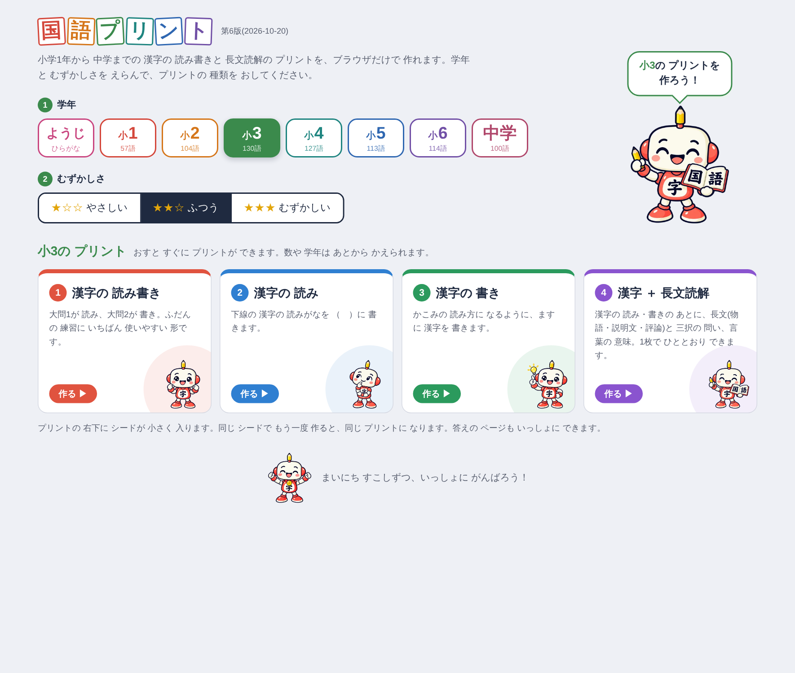
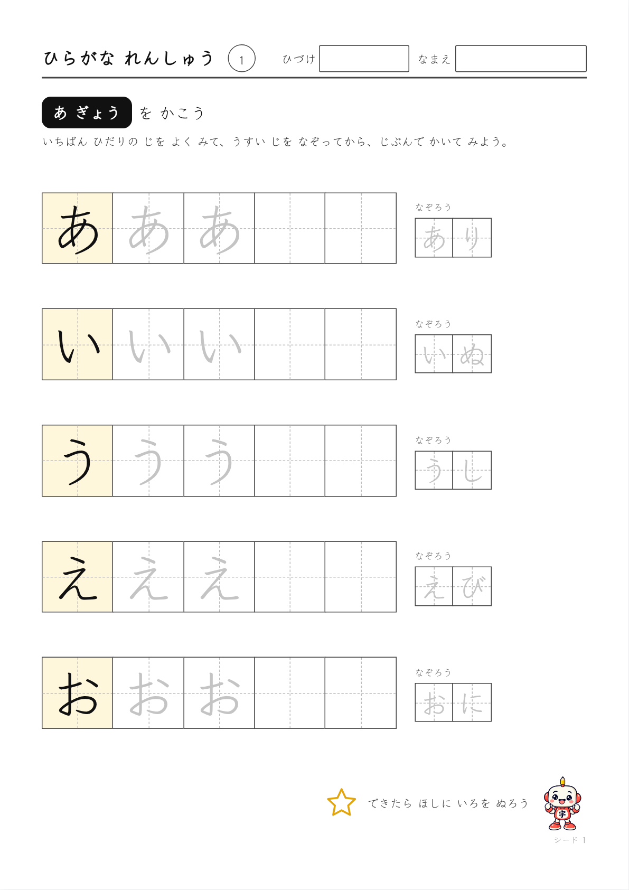
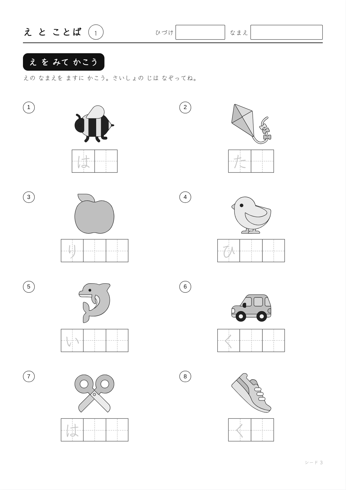
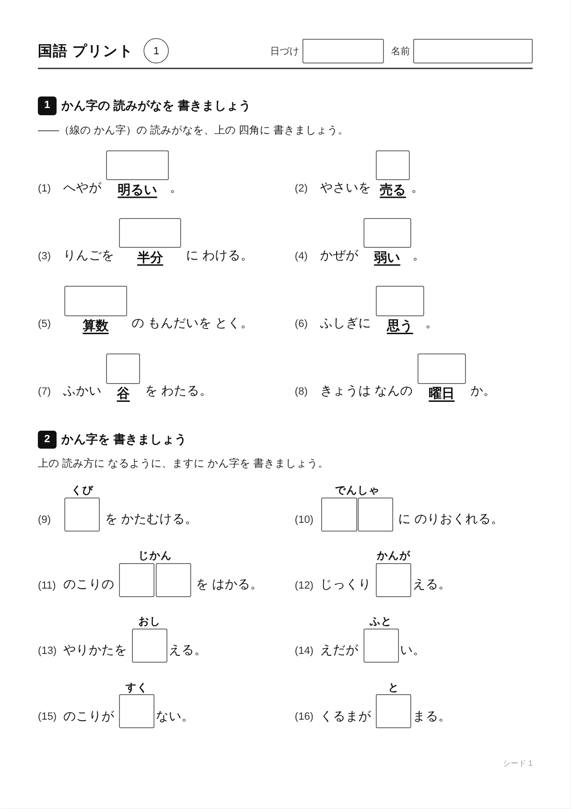
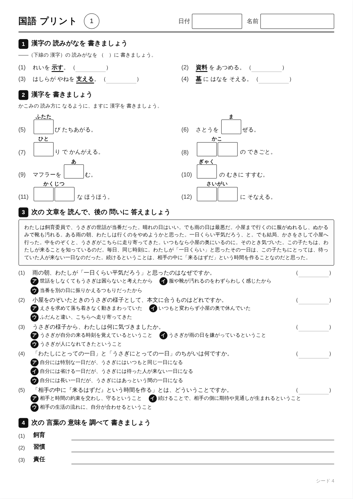
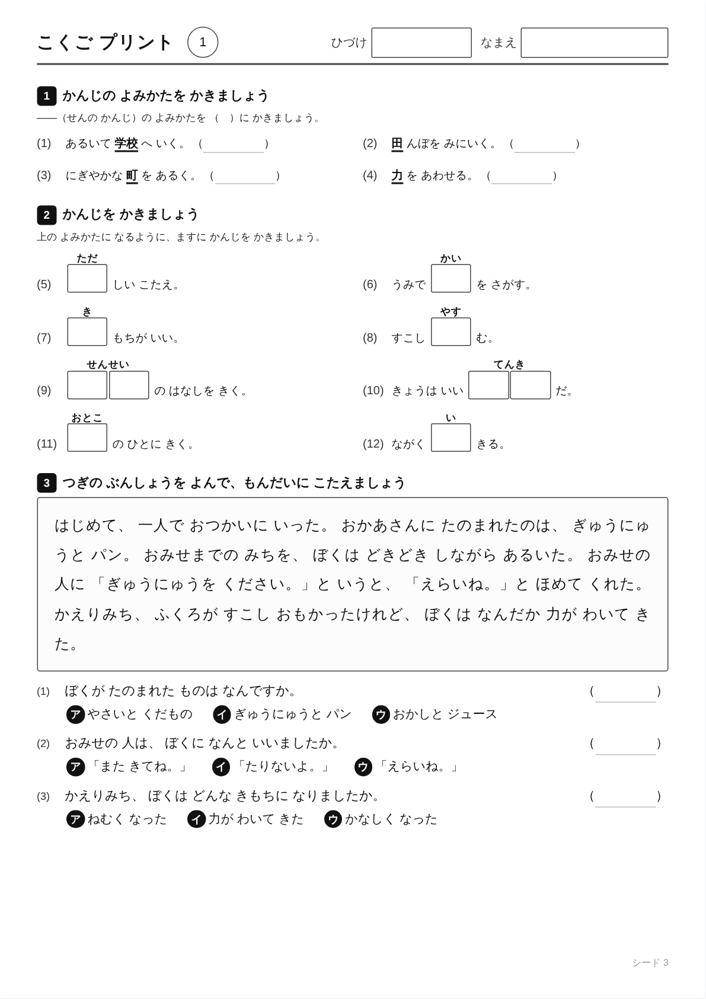
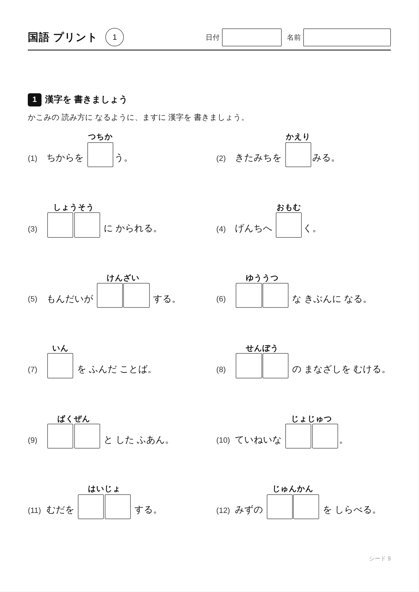
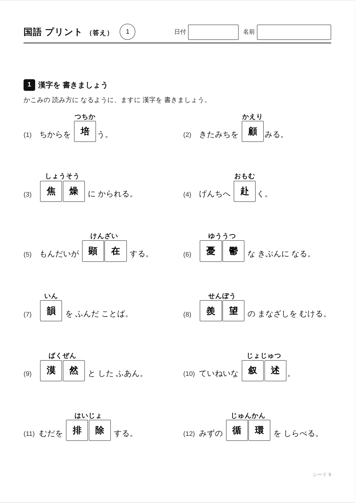

# 国語プリント

ようじ・小学1年〜小学6年・中学の 国語プリント(ようじは ひらがな・カタカナ、小学生からは 漢字と 長文読解)を、ブラウザだけで 作れる アプリです。
学年・種類・むずかしさを えらぶと、そのたびに 問題が かわる プリントと 答えの ページが できます。
インターネットに つながっていなくても、`docs/index.html` を 開くだけで 動きます(1 ファイルで 完結)。



| ようじ ひらがな なぞり | ようじ え を みて かこう |
|---|---|
|  |  |

| 小2 漢字の 読み書き | 小5 漢字 ＋ 長文読解 |
|---|---|
|  |  |

| 小1 漢字 ＋ 長文読解(見出しも ひらがな) | 中学 漢字の 書き |
|---|---|
|  |  |

| 中学 漢字の 書き | その 答えの ページ |
|---|---|
|  |  |

## できること

### ようじ(3〜6さい)

学年で「ようじ」を えらぶと、ようじ用の 5種類に かわります(見出しや 説明も ぜんぶ ひらがな)。

| 種類 | 中身 | まい数 |
|---|---|---|
| ひらがな なぞり | 1行に 1字。お手本(太わくの ます)→ うすい字 2つ → じぶんで 2つ。右に その字の ことば(あり・いぬ・うし …)を なぞる | あ行〜わ行・が行〜ぱ行の 15まい |
| カタカナ なぞり | ひらがなと 同じ 形。ことばは アイス・ケーキ・テレビ など | ア行〜パ行の 15まい |
| ことば なぞり | 1まいに 7語。うすい字を なぞって、となりの ますに じぶんで 書く | どうぶつ・くだもの・やさい・のりもの・からだ・むし・うみの いきもの・いろ・てんき・はる・なつ・あき・ふゆ・いえの なか・かぞく・ようちえん の 16テーマ |
| え を みて かこう | 絵を 見て、その なまえを ますに 書く(こあら・りんご・でんしゃ …)。1まいに 8つ。ひらがな・カタカナ、テーマ(どうぶつ・いきもの・たべもの・のりもの・もの・しぜん・からだ)、ヒント(さいしょの 字を なぞる/ぜんぶ なぞる/なし)を えらべる。こたえの ページつき | ひらがな 106・カタカナ 40の 絵から シードで 何まいでも |
| ことば あそび | しりとり(5語×4つ)・ことば さがし(6×6の ますに 6語)・たりない 字(8問)・ならべかえ(6問)。こたえの ページつき | シードで 何まいでも |

- 「れんしゅうする 行」「テーマ」「あそび」は「じゅんばんに」に すると、シード1 → あ行、2 → か行 … と かわります。「まとめて作る」で 15まい 作れば ひらがな 1さつに なります。
- プリントには キャラクターや 飾りを 入れません(キャラクターは 画面だけ)。
- 「え を みて かこう」の 絵は Microsoft の [Fluent Emoji](https://github.com/microsoft/fluentui-emoji)(フラット。MIT ライセンス)を、ビルドの ときに 白黒(うすい 灰色の ぬり + 黒い りんかく)に して 使います(`assets/pics/` → `tools/lineart.py`)。白黒で わかりにくい 絵(みかん・メロン など)は 入れて いません。
- ますには 十字の 点線が 入ります。なぞり書きの 字は 教科書体に ちかい [Klee One](https://github.com/fontworks-fonts/Klee)(SIL Open Font License)の かなだけを アプリに 入れて あります(`vendor/klee-kana.woff2`)。
- ことば あそびは、答えが 1つに なるように 作ります(たりない 字は ほかの 字で ことばに ならない ものだけ、ならべかえは ほかの ことばに ならない ものだけ)。`node tools/test/youji.js` で ぜんぶ 調べます。
- ことばは `tools/make_youji.py` の 表に あります。直したら `python3 tools/make_youji.py && python3 tools/build.py` を 走らせてください。

### 小学1年〜中学

- **学年**:小1・小2・小3・小4・小5・小6・中学(ぜんぶで 745 語)。プリントの 画面では 学年を 4つに 分けて えらべます
  - **子どもの 学年**:見出しの 字(小1・小2 は ひらがな 中心)と、ふりがなの 基準に なります。かえると 下の 3つも そろいます
  - **読みの 学年・書きの 学年・長文の 学年**:それぞれ べつの 学年に できます(たとえば 読みは 小4、書きは 小5、長文は 小4)
- **ふりがな**(長文読解):なし/習っていない 漢字だけ/すべての 漢字。「習っていない 漢字だけ」は、子どもの 学年までに 習わない 漢字が ある ことばに だけ つきます(学年別漢字配当表 1026字で 判定)。本文・問い・選択肢・言葉の 意味の すべてに つきます
- **種類**:
  - 漢字の 読み書き(大問1が 読み、大問2が 書き)
  - 漢字の 読み(下線の 漢字の 読みがなを （　）に 書く)
  - 漢字の 書き(かこみの 読み方に なるように ますに 漢字を 書く。おくりがなは ますの 外に 出ます)
  - **漢字 ＋ 長文読解**(漢字の 読み・書き → 長文と 三択の 問い → 言葉の 意味。1枚で ひととおり できる形。小1〜中学 ぜんぶの 学年で 作れます。選択肢は シードごとに 並べかわるので、答えが かたよりません)

    | 学年 | 話の 数(物語・説明文・評論) | 本文 | 問い | 言葉の 意味 | 漢字の 数(初め) |
    |---|---|---|---|---|---|
    | 小1 | 30話(物語20・説明文10) | 150〜195字・ひらがな中心・分かち書き | 3問 | なし | 読み4・書き8 |
    | 小2 | 30話(物語15・説明文15) | 225〜275字・分かち書き | 4問 | なし | 読み4・書き8 |
    | 小3 | 30話(物語15・説明文15) | 275〜360字・分かち書き | 5問 | 2語 | 読み4・書き8 |
    | 小4 | 40話(物語20・説明文20) | 420〜545字・分かち書き | 5問 | 2語 | 読み4・書き6 |
    | 小5 | 50話(物語25・説明文25) | 255〜345字 | 5問 | 3語 | 読み4・書き8 |
    | 小6 | 70話(小5と 共通の 50話 ＋ 小6だけの 20話。物語35・説明文35) | 255〜345字 | 5問 | 3語 | 読み4・書き8 |
    | 中学 | 70話(物語20・評論50) | 450〜980字 | 5問 | 2語 | 読み4・書き4(物語だけに すると 読み4・書き8) |

    - **長文の ジャンル**:すべて/物語/説明文/評論 から えらべます(その 学年に ある ジャンルだけ 出ます)。
      ジャンルを しぼると、その ジャンルの 話の 長さで 1枚に 入る 漢字の 数を 見つもります(中学の 物語は 評論より 短いので、漢字を 多く 入れられます)。

    - 小1〜小3 の 話は、学年別漢字配当表で その 学年までに 習う 漢字だけで 書いて あります(`tools/check_reads.py` で 検査)。
    - 小1・小2 の プリントは、見出しも その 学年で 読める 字だけで 出ます(「こくご プリント」「かんじを かきましょう」など)。
    - 低学年ほど 本文の 字を 大きく して います。
    - 本文が とくに 長い 話は、えらんだ 漢字の 数と いっしょに 1枚に 入らない ときだけ 使いません(漢字0問なら 全部の 話を 使います)。
- **むずかしさ**:★☆☆・★★☆・★★★
- **読みの 数・書きの 数**:べつべつに えらべます(0〜18問・0〜18問)。
  字は 大きめ(13pt)で、読みの 答えは 漢字の 上の 四角に 書きます(長文読解の プリントは これまでどおり （　） )。
  1行(2問)の 高さは 読み 約24mm・書き 約23.5mm なので、A4 1枚に 入るかどうかは くみあわせで かわります。入らない 数を えらぶと、
  さわっていない ほうが 自動で へります(たとえば 読み12問に すると 書きは 4問まで)。
  問題が 少ないときは、あまった 高さを 行の あいだに 同じだけ くばって、紙全体に バランスよく ならべます
- **答え**:答えの ページつき。問題と 同じ 形で 答えを 黒の 太字で 書きこんだ ものか、答えだけの 一覧を えらべます
- **お手本**:(1)だけ うすい字で 答えを 入れられます(なぞり書き用)
- **シード**:同じ シードなら 同じ プリントが もう一度 作れます。プリントの 右下に シードが 小さく 入ります
- **まとめて作る**:1〜100ページを まとめて 画面に 出す・PDF・JPG(zip) で 保存できます

**画面**:えらんだ 学年の 色(小1 赤・小2 オレンジ・小3 緑・小4 青緑・小5 青・小6 むらさき・中学 えんじ)が 画面ぜんたいに つきます。**プリントは すべて 白黒** です(答えの 字も 黒。白黒の プリンターで そのまま 使えます)。

**例文は、ねらいの ことば いがい ぜんぶ ひらがな** です。そのため、習っていない 漢字が まざることが ありません。

## 使い方

1. `docs/index.html` を ダウンロードして、Edge か Chrome で 開きます。
2. メニューで 学年と むずかしさを えらび、「漢字の 読み書き」などの ボタンを おします。
3. 「印刷」で 印刷します。「まとめて作る・保存」で、まとめて PDF・JPG に できます。

### GitHub Pages で 公開する

**Settings → Pages → Build and deployment** で
「Source: Deploy from a branch」「Branch: `main`」「フォルダ: `/docs`」を えらんで 保存します。

## フォルダの 構成

```
.
├─ docs/
│  ├─ index.html        ← できあがった アプリ(これだけで 動く。GitHub Pages の 公開先)
│  └─ screenshots/      ← README 用の 画像
├─ src/
│  ├─ template.html     ← アプリの 本体(画面・プリントの 組み立て)
│  └─ data/
│     ├─ words1.tsv 〜 words6.tsv   ← 小1〜小6 の 語いバンク
│     ├─ words7.tsv                 ← 中学 の 語いバンク
│     ├─ read1.json 〜 read7.json   ← 長文読解の 話(小6 は read5 ＋ read6 を 使う)
│     ├─ layout.json                ← 長文の 話ごとの 高さ(ふりがな なし・ありの 両方。tools/measure_layout.js が 書く)
│     ├─ ruby.json                  ← 長文の ふりがな(tools/furigana.py が 作る)
│     ├─ youji.json                 ← ようじの 行・ことば(tools/make_youji.py が 作る)
│     └─ kanji_grades.json          ← 学年別漢字配当表(平成29年告示。小1 80・小2 160・小3 200・小4 202・小5 193・小6 191 字)
├─ assets/pics/         ← ようじ「え を みて かこう」の 絵(Fluent Emoji。MIT。ビルドで 白黒に する)
├─ assets/chara/        ← 画面の キャラクター画像(webp。book・guide・cheer・think・idea・maru・banzai の 7枚)
├─ vendor/              ← PDF・JPG・zip 用の 道具(html2canvas / jsPDF / JSZip)、ようじの なぞり書きの フォント(Klee One の かなだけ)と ライセンス
├─ tools/
│  ├─ build.py          ← 1 ファイルに まとめる
│  ├─ check_words.py    ← 語いバンクの 検査
│  ├─ check_reads.py    ← 長文の データの 検査(小1〜小3 は 配当漢字も)
│  ├─ furigana.py       ← 長文に ふりがなを つけて ruby.json を 作る(形態素解析 fugashi を 使う)
│  ├─ measure_layout.js ← 長文の 話ごとの 高さを 実測して layout.json に 書く
│  └─ test/             ← 検査(Playwright)
└─ .github/workflows/check.yml ← push した ときの 自動検査
```

`docs/index.html` は `tools/build.py` で 作る ファイルです。直接は 書きかえず、`src/` を 直してから 作り直してください。

## 作り直し方

```sh
python3 tools/build.py
```

## 検査

```sh
python3 tools/check_words.py     # 語いバンクの 形・例文に 漢字が まざっていないか・重複
node tools/test/layout.js        # 全部の くみあわせで プリントを 作り、はみ出し・番号の ずれを 見る
node tools/test/counts.js        # 読み・書きの 数の くみあわせ ぜんぶで、1枚に 入るか・問題数が 合うかを 見る
python3 tools/check_reads.py     # 長文の データ(形・へんな 文字・小1〜小3 の 配当漢字)
node tools/test/youji.js         # ようじの プリントを ぜんぶ 作り、1枚に 入るか・ことば あそびの 答えが 正しいかを 見る
node tools/test/shots.js         # README 用の 画像を とり直す
```

`check_words.py` は、語いバンクの 語に その 学年で まだ 習わない 漢字が ないかを、
学年別漢字配当表(`src/data/kanji_grades.json`)で 調べます。

## 語いを 足すとき

`src/data/words<学年>.tsv` に 1行 足すだけです。タブ区切りで 4つ。

```
研究	けんきゅう	むしを {} する。	2
```

| 列 | 中身 |
|---|---|
| 1 | 語(漢字を 1つ いじょう ふくむ) |
| 2 | 読み(かなだけ) |
| 3 | 例文。`{}` が 語の 入る ところ。**ほかは ぜんぶ ひらがな** |
| 4 | むずかしさ 1・2・3 |

足したら `python3 tools/check_words.py` → `python3 tools/build.py` の 順に 走らせてください。

## 長文を 足すとき

`src/data/read<学年>.json` に、次の形で 足します。`read4.json`(小4)・`read7.json`(中学)を 置けば、その 学年でも 長文読解が 作れるように なります。

```json
[
 {
  "id": "g561",
  "genre": "expo",
  "passage": "本文...",
  "questions": [
   { "q": "設問...", "c": ["ア の 文", "イ の 文", "ウ の 文"], "a": 1 }
  ],
  "vocab": ["配置", "効率", "集中"]
 }
]
```

`genre` は ジャンルで、`story`(物語)・`expo`(説明文)・`essay`(評論)の どれかです。
`a` は 正解の 番号(0 が 一つ目)です。選択肢は アプリ側で シードごとに 並べかえ、正解の 記号も それに 合わせて 付け直すので、`a` の かたよりは 気に しなくて かまいません。

## これから 足すところ

- 読解(物語文・縦書き)の プリント
- 部首・筆順・同音異義語

## 著作権・ライセンス

国語プリントの 著作権は、落合聡一に あります(© 2026 落合聡一)。

- プログラムと 語いバンクは [MIT ライセンス](LICENSE) です。だれでも 自由に 使う・コピーする・書きかえる・配ることが できます(著作権表示と LICENSE の 文は のこしてください)。
- `assets/chara/` の キャラクター画像は MIT ライセンスに ふくまれません。著作権は 落合聡一に あり、許可なく 使うことは できません。
- `assets/pics/` の 絵(Fluent Emoji。© Microsoft・MIT)と、`vendor/` の html2canvas(MIT)・jsPDF(MIT)・JSZip(MIT または GPLv3)・Klee One(SIL Open Font License 1.1)は 落合聡一の 作ったもので は ないため、それぞれの 作者の ライセンスに したがいます(`vendor/licenses/`)。

## 1枚に 入るかの 見つもり

`src/template.html` の `LAYOUT` に、実測した 高さ(mm)が 入っています。

| | 土台 | 大問1つ | 読み 1行 | 書き 1行 | 上限 |
|---|---|---|---|---|---|
| ふつう | 48.5 | 23.2 | 24.3 | 23.5 | 292 |
| 長文 | 193 | 16.6 | 6.9 | 13.4 | 294 |

1行は 2問です。文字の 大きさや ますの 大きさを かえたときは、`node tools/test/counts.js` を 走らせて、
はみ出しが 出たら この 数を なおしてください。

### ふりがなを 作り直す

長文の 話を 足したり 直したり したら、ふりがなも 作り直します。形態素解析に fugashi と 辞書 unidic-lite を 使います。

```sh
pip install 'fugashi[unidic-lite]'     # はじめに 1回(うまく 入らない ときは python3 -m venv で 仮想環境を 作って その 中に)
python3 tools/furigana.py
```

読みまちがいを 見つけたら、`tools/furigana.py` の `FIX` に「語: 読み」を 足して もう一度 走らせます
(いまは「一日→いちにち」「五色→ごしょく」「私→わたし」「既読→きどく」などを 入れて あります)。

### 長文の 話を 足したら

話の 長さで 1枚に 入る 漢字の 数が かわるので、次の 順に 走らせてください。

```sh
python3 tools/check_reads.py
python3 tools/furigana.py
python3 tools/build.py && node tools/measure_layout.js && python3 tools/build.py
node tools/test/counts.js
```

`measure_layout.js` は、学年ごとと「学年:ジャンル」ごとに 土台の 高さを 書きます。話ごとに 選択肢の ならび 6通りを ぜんぶ 組んで、いちばん 高く なる 場合の 高さを 記録します
(選択肢は シードで 並べかわり、ならびに よって 折り返しが かわるため)。
